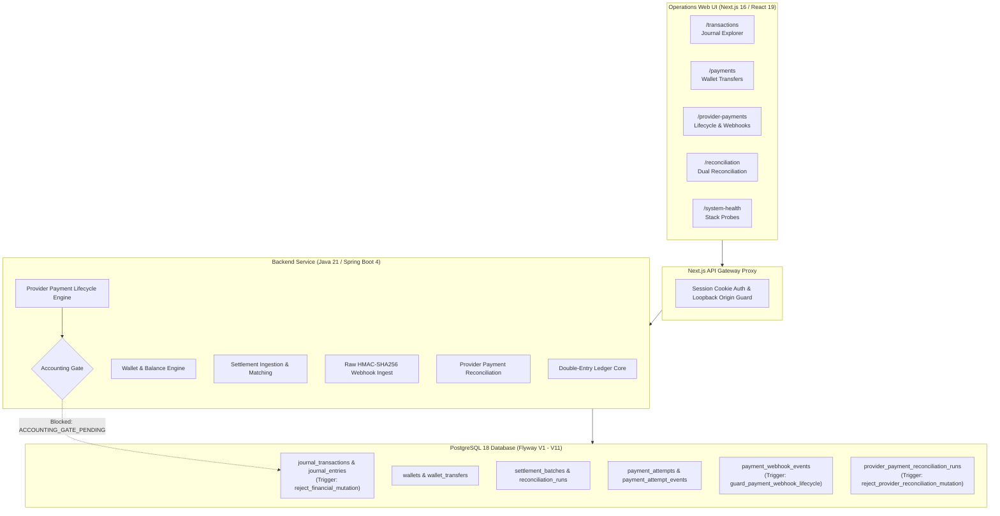

# Ledger Platform — Demo Walkthrough & Showcase Guide

This guide outlines the end-to-end operational walkthrough and showcase narrative for the **Ledger Platform** project. All demonstrations use synthetic data, isolated review containers, and Razorpay Test Mode instruments.

---

## 1. Executive Summary & Value Proposition

Ledger Platform is a production-oriented financial system engineered around core transactional invariants:
- **Strict Double-Entry Bookkeeping**: Every transaction balances debits and credits to the exact minor unit ($0.00$ discrepancy).
- **PostgreSQL Immutability Triggers**: Posted financial records cannot be updated or deleted at the SQL level. Corrections require explicit, audit-logged reversals.
- **Durable, Idempotent Event Ingestion**: Webhooks from external providers (Razorpay Test Mode) are verified using raw HMAC-SHA256 signatures, deduplicated via unique database constraints, and processed through a forward-only lifecycle state machine.
- **Dual Reconciliation Engine**: File-based settlement batch reconciliation plus automated provider payment capture reconciliation.
- **Non-Negotiable Accounting Gate**: Provider payments remain strictly `ACCOUNTING_GATE_PENDING` until target accounting debit/credit policies are formally approved.

---

## 2. Architecture & Invariant Enforcement

---

## 3. Step-by-Step Operator Walkthrough

### Stage 1: System Health & Infrastructure Verification
1. Navigate to **http://localhost:3000/system-health**.
2. **Observe**:
   - Backend Readiness and Liveness probes reporting `UP`.
   - PostgreSQL connectivity verified with Asia/Kolkata timezone session configuration.
   - 11 Flyway migrations applied cleanly (V1 initial schema through V11 provider reconciliation).

### Stage 2: Double-Entry Transactions & Atomic Wallet Transfers
1. Navigate to **http://localhost:3000/transactions**.
   - Inspect posted journal transactions with balanced debits and credits.
   - Note the immutability enforcement: no edit or delete buttons exist; database triggers reject direct mutation attempts.
2. Navigate to **http://localhost:3000/payments**.
   - View seeded demo wallets (e.g. `demo:shubham:INR`, `demo:ashwin:INR`, `demo:swati:INR`).
   - Execute a simulated transfer (e.g. transfer INR 50.00 from Shubham to Swati).
   - Confirm immediate atomic transfer execution with balance validation and negative balance prevention.

### Stage 3: Razorpay Test Mode Payment Lifecycle
1. Navigate to **http://localhost:3000/provider-payments**.
2. **Create Payment Attempt**:
   - Enter Amount: `15.00`, Purpose: `Client Retainer Demo`, Business Reference: `INV-2026-DEMO-01`.
   - Click **Create test payment**.
3. **Launch Test Checkout**:
   - The interactive Razorpay Test Mode checkout modal opens.
   - Use Razorpay test card credentials (e.g. dummy OTP / authorization success).
   - Upon completion, the backend verifies the payment signature server-side.
4. **Lifecycle Stepper**:
   - The visual lifecycle stepper transitions in real time to `CAPTURED_VERIFIED`.
   - **Notice**: Accounting status prominently indicates **`ACCOUNTING_GATE_PENDING`** (no funds are posted to financial ledger accounts).

### Stage 4: Durable Webhook Intake, Deduplication & Safe Replay
1. Inspect the **Webhook Evidence** table below the selected payment attempt.
2. **Verify Captured Event**:
   - Event `payment.captured` is displayed with unique provider event ID, attempt count `1`, and state `PROCESSED`.
3. **Test Replay Action**:
   - Click the **Replay** button on the webhook event.
   - The backend processes the replay idempotently, returning `ALREADY_PROCESSED` without trigger violation or duplicate database state transitions.

### Stage 5: Dual Reconciliation Engine
1. Navigate to **http://localhost:3000/reconciliation**.
2. **Tab 1: Settlement Batches (File-based)**:
   - Review imported settlement CSV batches.
   - Inspect row-level validation (`VALID` vs `INVALID`) and execution of settlement reconciliation runs.
3. **Tab 2: Provider Payments (Razorpay)**:
   - Switch to the **Provider payments (Razorpay)** tab.
   - Review recorded reconciliation runs.
   - Click **Run reconciliation** to execute the deterministic matching engine against the active database.
   - Inspect the classifications table:
     - `MATCHED`: Internal captures verified against external webhook records.
     - `UNMATCHED_INTERNAL` / `UNMATCHED_PROVIDER`: Asymmetrical evidence records.
     - `DUPLICATE`: Multiple provider capture events for a single payment.
     - `CONFLICTING`: Mismatched amount or currency.
   - Use the outcome dropdown to filter classifications.

---

## 4. Key Engineering Decisions & Defensibility

| Decision | Implementation | Why it Matters |
|---|---|---|
| **PostgreSQL-Level Immutability** | PL/pgSQL trigger `reject_financial_mutation()` | Guarantees financial audit integrity even if application logic or administrative scripts are compromised. |
| **Authoritative Webhook Deduplication** | Database constraint `UNIQUE (provider, environment, provider_event_id)` | Prevents duplicate event processing across multi-instance or retrying webhook consumers without relying solely on memory caches. |
| **Forward-Only Payment State** | Explicit state transition graph | Prevents out-of-order or late events (e.g. delayed `payment.authorized` arriving after capture) from regressing system state. |
| **Strict Accounting Gate** | Hardcoded gate check before journal insertion | Prevents automated money creation or balance distortion from untrusted external payment gateways until accounting sign-off. |
| **Same-Origin Next.js Proxy** | Strict loopback origin validation + HttpOnly signed cookie | Shields backend Basic credentials from browser exposure and prevents cross-site request forgery. |

---

## 5. Scope & Disclaimer

> [!NOTE]
> This platform is an engineering demonstration of financial software architecture, distributed systems patterns, and data integrity guarantees. It is strictly configured for local execution with Razorpay Test Mode credentials. No real financial accounts, actual money movement, recipient payouts, or live payment gateway connections are enabled.
